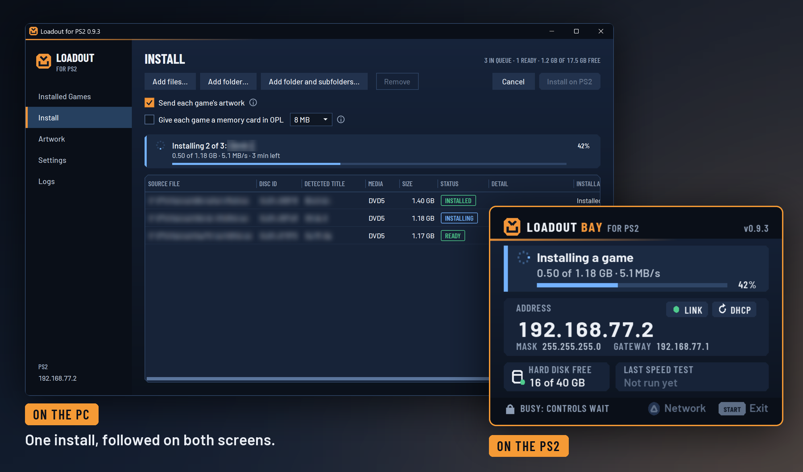
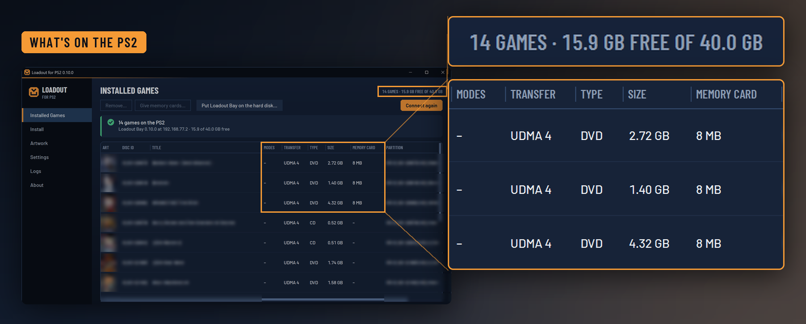
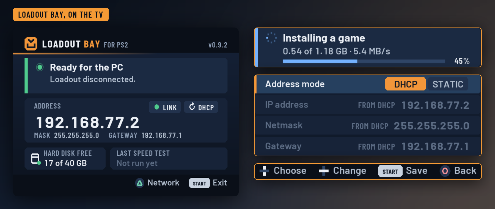
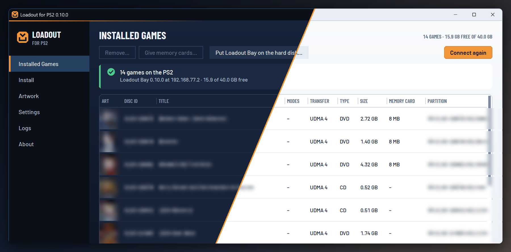

# Loadout for PS2

Back up your PlayStation 2 discs on a Windows PC, and install games and artwork on the PS2 over the network.

Loadout has two parts:

- **Loadout for PS2** is the Windows app. It backs up original PS2 discs from a disc drive on the PC, checked against Redump, and sends games and artwork to the PS2.
- **Loadout Bay for PS2** is the PS2 app. It receives games and artwork and writes them to the PS2's internal hard disk, in the layout Open PS2 Loader (OPL) reads.

Both parts share one version number.

<!-- showcase:start -->

### Back up your discs

Put an original PS2 disc, DVD or CD, in your PC's drive. Loadout copies it, checks the copy against [Redump](http://redump.org)'s list of verified discs so you know it's exact, and names it as Redump does. A scratched disc is read in passes that go back to its weak spots. A map of the disc shows where the trouble is, Loadout tells you when cleaning would help, and the copy goes on where it was. Stop and resume any time. Tick Also install on PS2 and the game goes to the PS2 as it's copied.

### Send games from your PC

Queue iso, bin and cue, or chd files. Loadout sends them over your network, with their artwork, and checks each game after installing it. A chd is read as it's sent, with no converted copy on your disk.

### See what's on the PS2

Covers, sizes, memory cards and free space. Change a game's title or modes, give games a memory card, or remove them.

### Follow it on the TV

Loadout Bay shows its address, progress and free disk space. Set its network from the controller.

### Light or dark

Choose a theme, or follow Windows.

<!-- showcase:end -->

## Before you start

Loadout does not set up the PS2 for you. You need all of this first.

On the PC:

- 64-bit Windows 11, version 24H2 or later, or 64-bit Windows 10. On Windows 10 Enterprise LTSC 2021 (version 21H2), Loadout passes its tests, connects to Loadout Bay, and installs games, though its installs from there have only gone to Loadout Bay in the PCSX2 emulator. No other Windows 10 version has been tried. Apart from its LTSC editions, Microsoft does not support .NET 10 on Windows 10. Windows on Arm has not been tested.
- The x64 [.NET 10 Desktop Runtime](https://dotnet.microsoft.com/download/dotnet/10.0), which Loadout does not include.
- Nothing to install for SQLite: Loadout uses the copy that comes with Windows (`winsqlite3.dll`). It avoids newer SQLite features and passes its tests on versions as old as 3.12.2. To see your version, run `(Get-Item C:\Windows\System32\winsqlite3.dll).VersionInfo.ProductVersion` in PowerShell. If Windows has no such file, Loadout says so when it starts.
- A network connection to the same network as the PS2.
- To back up discs: a DVD drive, built in or USB. Backing up needs nothing else, no PS2 at all.

On the PS2:

- **A fat PS2** (SCPH-3000x to SCPH-5000x) with the official network adapter or a compatible one, and an internal hard disk. Slim models have no internal hard disk, so they cannot receive games.
- **A hard disk formatted for the PS2.** Loadout Bay does not format disks. wLaunchELF's HDD Manager can. Only the PS2's first internal hard disk is used.
- **A way to start homebrew and run an ELF from a USB drive**, such as FreeMcBoot or Free HDBoot with [wLaunchELF](https://github.com/ps2homebrew/wLaunchELF), to start Loadout Bay the first time. Other launchers should work too, as long as they tell Loadout Bay where it was started from, which it needs to save its settings and updates. wLaunchELF and OPL's Apps menu are the ones it has been tried with.
- **[Open PS2 Loader](https://github.com/ps2homebrew/Open-PS2-Loader)**, which plays the games. Loadout only installs them.
- **A USB drive formatted as FAT32.** Loadout Bay also starts from a memory card, but updates sent from Loadout can only be saved to a USB drive or the hard disk.

Loadout is a prerelease. It writes to your PS2's hard disk, and so far it has been tested on one console, so back up anything you can't replace. Please report problems on the [issues page](https://github.com/IVazharov/loadout-ps2/issues).

## Get started

1. Start OPL on the PS2, set **Settings → HDD Device Start Mode** so it lists games from the hard disk, and open that list once. This makes the partition that artwork, game settings, and memory cards go in. OPL makes it 128 MB: room for about a dozen 8 MB memory cards beside the artwork, and it can't safely be made bigger later. For more, create a partition named `+OPL` of the size you want with wLaunchELF's HDD Manager before OPL first opens that list, and OPL uses it instead. 1 GB holds cards for about a hundred games.
2. Download both zips from the [releases page](https://github.com/IVazharov/loadout-ps2/releases).
3. Copy `loadout-bay.elf` to the USB drive and start it with your homebrew launcher, such as wLaunchELF. Its screen shows the PS2's address.
4. Unzip Loadout anywhere you can write and run `LoadoutPS2.exe`. It keeps its settings and caches next to the executable. It's signed by Open Source Developer Ivan Vazharov, and runs with Smart App Control on. The certificate is new, so Windows may still warn you about it.
5. In Settings, press **Find Bay** or enter the address from the TV.
6. On **Install**, add iso, bin and cue, or chd files, then press **Install on PS2**.
7. Start OPL on the PS2. It lists the games from its hard disk section.

To start Loadout Bay without the USB drive from then on, see [From the hard disk](ps2/README.md#from-the-hard-disk).

If OPL has already made its 128 MB partition and the memory cards need more room, OPL can move to a bigger one, saves included. Create it with wLaunchELF's HDD Manager under a name that starts with `+`, such as `+OPL2`, and copy everything in `+OPL` into it with wLaunchELF's file browser, the memory cards in `VMC` and Loadout Bay in `APPS` too. Then change the line in `hdd0:/__common/OPL/conf_hdd.cfg` to `hdd_partition=+OPL2`. OPL and Loadout Bay both use the partition that file names. Keep the old `+OPL`, as some setups start OPL itself from it.

## What Loadout downloads

Loadout goes online for three things only:

- Game titles and settings data come from the [PS2-OPL-CFG-Database](https://github.com/Thecat1080/PS2-OPL-CFG-Database) by Thecat1080.
- Artwork comes from the [psx-ps2-opl-art-database](https://github.com/Luden02/psx-ps2-opl-art-database) by Luden02, when you press **Download artwork**. The images belong to their owners.
- When Loadout starts, and when you press **Check for updates** on the About page, Loadout reads its list of releases from GitHub. A newer version is downloaded only when you press **Update now**. Settings, **Updates**, turns the check at start off.

The game data and the artwork are not part of Loadout or under its licence.

## Downloads

Each release has two downloads:

- `Loadout-PS2-<version>-win-x64.zip` holds `LoadoutPS2.exe`, this readme, and the licence texts.
- `Loadout-Bay-PS2-<version>.zip` holds `loadout-bay.elf`, an example network settings file, a short readme, and the licence texts.

## Docs

- [Loadout Bay](ps2/README.md): starting it, and its network settings.
- [Protocol](docs/bay-protocol.md): how the two parts talk.
- [Speed test](docs/speed-test.md): measuring the network and the hard disk.
- [Contributing](CONTRIBUTING.md): building and testing both apps.

## Licence

The source code written for Loadout and Loadout Bay is under the MIT licence: see [LICENSE](LICENSE). The downloads also contain other projects' code, under their own licences: [THIRD-PARTY-NOTICES.txt](THIRD-PARTY-NOTICES.txt) lists them, and comes with both downloads. By using or redistributing the binaries you accept those licences. Code taken from other projects is in `ps2/third_party/` and `src/Loadout.Core/ThirdParty/`. The Barlow fonts in `ps2/assets/fonts` and `src/Loadout.App/Assets/Fonts`, and `ps2/src/font_data.c`, which is rendered from them, are under the SIL Open Font License 1.1.

Maintained by Ivan Vazharov.

## Notice

Loadout works with disc images you made from discs you own. It does not include or download games, BIOS files, or Sony code, and the project gives no help finding them. PlayStation and PS2 are trademarks of Sony Interactive Entertainment; this project is independent, and not affiliated with or endorsed by Sony.
